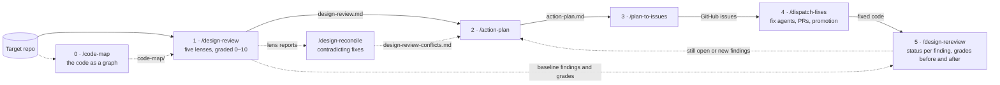

# Remediation pipeline

Claude Code skills and subagents that take an application from design review to verified fixes in five stages, with an optional code map before the first and an optional conflict check after it. Each stage writes an artifact into `docs/remediation/` in the target repo, and the next stage reads it, so findings stay traceable all the way to a merged pull request.



| Stage | Skill | Agents | Reads | Writes |
|---|---|---|---|---|
| 0 | `/code-map` (optional) | none; one script | repo | `code-map/`: `graph.json` plus views of modules, entry points, data and front end |
| 1 | `/design-review [lenses]` | `architecture-reviewer`, `backend-reviewer`, `frontend-reviewer`, `ux-reviewer`, `security-reviewer` (read-only, run in parallel, three at a time by default) | repo | `design-review.md`, merged from one file per lens; findings `F-ARC/BE/FE/UX/SEC-nnn` |
| 1b | `/design-reconcile` (optional) | `conflict-reviewer` (read-only) | lens reports + repo | `design-review-conflicts.md`; conflicts `X-nnn`, each with a resolution or a decision for the team |
| 2 | `/action-plan` | `remediation-planner` (read-only) | review, conflicts if present, repo | `action-plan.md`; actions `A-nnn` |
| 3 | `/plan-to-issues` | `ticket-writer` (drafts only) | plan | `tickets.md`; tickets `T-nn`, then GitHub issues |
| 4 | `/dispatch-fixes` | `fix-agent` × N (one per group, own worktree, three at a time by default) | open issues + plan | `dispatch.md`; groups `G-nn`, branches, PRs |
| 5 | `/design-rereview [lenses]` | the same five reviewers (read-only, three at a time by default) | earlier review + current code | `design-rereview-<date>.md`; a status for every earlier finding, grades before and after |

Every stage also leaves a run record in `docs/remediation/work/<stage>/` (what ran, on which commit, every intermediate output and each gate result) and a page for people in `docs/remediation/pages/<stage>.html`: the whole artifact with folding sections, cross-linked IDs and filterable tables, under a dashboard of scores, counts and graphs. `skills/design-review/scripts/page.py` renders it from the artifact, so no model writes it, and each skill offers to publish it as a private claude.ai Artifact.

Stages 3 and 4 change external state (GitHub issues, merges, promotion to whatever branch the target repo promotes to) and always stop for explicit approval first.

The skills that fan out agents (`/design-review`, `/design-rereview`, `/dispatch-fixes`) run at most three at a time. Say another number to change it, for example `/design-review max 5` or "one at a time".

The repo also carries the [minify harness](harness/minify/README.md), which is separate from the pipeline.

## Stage 0: code map

Every reviewer starts by working out the same things: where the entry points are, what guards them, what they reach, who owns each table. `/code-map` does that once, mechanically, and writes `docs/remediation/code-map/` in the target repo. The later stages read it when it is there and work as before when it is not.

| View | Holds |
|---|---|
| `modules.md` | most depended-on files, import cycles, folders that depend on each other both ways |
| `entry-points.md` | every route with its middleware in running order, handler and tables reached; jobs, queues and schedules |
| `data.md` | readers and writers of each table; tables written from more than one folder |
| `frontend.md` | client routes, API calls, and client calls and server routes that do not match up |

`skills/code-map/scripts/codemap.py build <repo>` produces the map. It uses code-graph-rag (`cgr`) when installed, which adds functions and call edges, and otherwise a builtin engine with no dependencies that covers TypeScript, JavaScript and Python at file level. The same script answers questions about the graph: `impact <file>`, `route <text>`, `table <name>`, `deps`, `rdeps`, `callers`, `callees`; and `status <repo>` says whether the map still matches the code.

The map is extracted by pattern, so it gives a file and line to open, not a proven fact. Reviewers cite the code, never the map.

## Stage 1: design review

`/design-review` runs one agent per lens, each writing its own report, then merges them into a single document with one prioritization matrix. Pass lens names to narrow it: `/design-review security`, `/design-review backend frontend`. With no argument it runs all five and skips `frontend` and `ux` when the repo has no client code.

| Lens | Covers |
|---|---|
| `architecture` | boundaries, coupling, data ownership, CAP analysis of each data store, state machines, scalability shape, deployment safety, operability, test strategy |
| `backend` | idempotency, dual writes, concurrency, performance, resilience, queues, API contracts |
| `frontend` | client code: state and data flow, submits, error states, forms, routing, performance, accessibility implementation, build config |
| `ux` | the experience: task flows and friction, navigation, feedback, error recovery, copy, consistency, onboarding, responsive behavior, trust |
| `security` | authn, authz, tenant isolation, input handling, webhooks, secrets, client security, data protection, supply chain, AI risks, OWASP Top 10 coverage |

Every finding cites concrete evidence, carries a confidence label (Confirmed / Likely / Needs verification), a step-by-step scenario, the smallest safe fix and a verification step. Each lens also grades every aspect it checks from 0 to 10, shown as a gauge such as `▰▰▰▰▰▰▰▱▱▱ 7/10`, and the merged report adds a score per lens and one overall score. A Critical or High finding caps the grades it touches, and `skills/design-review/scripts/scorecard.py` computes the scores so the numbers never rest on a model's arithmetic. Shared rules live in `skills/design-review/references/conventions.md`.

## Between stages 1 and 2: conflict check

Each lens works alone, so two lenses can prescribe fixes that cannot both hold: security shortens a session that UX wants kept alive, or two lenses redesign the same function differently. Planned as written, those fixes reopen each other's findings. `/design-reconcile` hands every lens report to one `conflict-reviewer` agent, which tests suspected pairs against the code and reports each real conflict with the concrete collision, what happens when both fixes are applied, and a resolution: one combined remediation, one fix preferred over the other, a fix order, or a decision the team has to make.

`skills/design-reconcile/scripts/conflicts.py candidates` lists the paths cited by more than one finding as a starting point, and `check` refuses to pass when a conflict cites a finding that does not exist, has no resolution, or when the fix orders of all conflicts together form a cycle. `/action-plan` reads the conflicts file when it is there and plans the resolved remediation instead of both sides.

## Recorded decisions

A review that does not know what the team decided re-flags deliberate trade-offs, the plan reverses them, and the next review flags the reversal. Every stage that reads code therefore starts from a decisions digest written by `skills/design-review/scripts/decisions.py collect`: the repo's ADR-style records, the instruction files that carry decisions, the register `docs/remediation/decisions.md`, and the decisions still open, plus what `/design-memory` finds. A finding that touches a decision says how: `accepted` (the risk the decision took on, reported at its real severity but not planned), `drift` (the code broke the decision, so the fix restores it) or `revisit` (the decision's premise changed, so it goes back to the team with options). When the user answers a `decision` conflict or an entry of the plan's decision log, the skill appends it to the register as a `D-nnn`, so the next review starts from it. The architecture lens also inventories the load-bearing decisions the code shows, recorded or not, with what each costs today, whether its premise still holds and how hard it is to reverse; `/action-plan` drafts records for the unrecorded ones that are costly to reverse, in the repo's own format, and moves them into the repo only when the user says so.

## Stages 2 to 4

- **`/action-plan`** normalizes the findings, validates the High and Critical ones against the code, scores risk transparently, and produces a four-layer plan (containment, near-term, hardening, long-term) of implementation-ready work items with tests, rollout, rollback and observability.
- **`/plan-to-issues`** drafts one ticket per action following the target repo's own conventions: its `.github/ISSUE_TEMPLATE` types, labels, `[BUG-000]`-style titles and headings, plus any setup guide such as `docs/github_issues_setup.md`. It falls back to `skills/plan-to-issues/references/issue-template.md` when the repo has no templates. After a confirmation, `skills/plan-to-issues/scripts/create_issues.py` creates the issues with `gh` in dependency order. It fills work-item numbers after creation, rewrites `T-nn` references to real `#numbers`, creates missing template labels with their documented colors, records the mapping in `tickets.md` and resumes safely after a failure. Run it without `--create` for a dry run, and with `--fix-refs` to finish issues left with unresolved references.
- **`/dispatch-fixes`** groups open issues into low-conflict batches and writes an agent brief per group (`skills/dispatch-fixes/references/agent-brief.md`). It names branches, commits and PRs by the repo's own workflow, for example `bugfix/351-short-desc` and `[BUG-351] …`, and confirms the working and promotion branches before dispatching. It dispatches one `fix-agent` per group in an isolated worktree, then drives integration: validate the PR, ask before merging into the working branch, ask before promoting, verify, comment on and close issues.

## Stage 5: re-review

`/design-rereview [lenses]` measures what changed since the first review. Each lens starts from the earlier findings and the code that changed since the baseline commit, so it costs less than a fresh review. It gives every earlier finding a status, which is Fixed, Partially fixed, Open, Regressed, Accepted or Not verifiable, each backed by the current code rather than by a closed issue. It also looks for problems the changes introduced, re-grades every aspect, and compares before and after per aspect, per lens and overall.

`skills/design-rereview/scripts/compare.py` computes that comparison and refuses to pass while any earlier finding lacks a status. When the first review predates grading, the baseline grades are reconstructed from its findings with the same rubric and labelled as such. The report goes to `docs/remediation/design-rereview-<date>.md` and never overwrites the baseline.

## Memory

`/design-memory` saves and recalls durable memory through the best system on the machine: ai-memory when it is installed and its server answers, else the claude-mem plugin, else Claude Code's MEMORY.md files. `skills/design-memory/scripts/memory_backend.py` makes the choice, and as a SessionStart hook it tells every session which tier is active and warns when ai-memory and claude-mem both capture sessions. claude-mem has no write tool, so under it deliberate memories go to MEMORY.md. Rules the team follows stay in `AGENTS.md`, `CLAUDE.md` or decision records; memory holds history, preferences and decisions tagged so other projects can find them. The conflict check and the action plan offer to save the decisions a person approved.

Install the hook in `~/.claude/settings.json` under `hooks.SessionStart`:

```json
{"matcher": "*", "hooks": [{"type": "command", "timeout": 10,
  "command": "f=~/.claude/skills/design-memory/scripts/memory_backend.py; [ -f $f ] && python3 $f hook || true"}]}
```

## Minify harness

`harness/minify/` makes Claude Code emit code minified, formats it back with the project's own formatter at the end of the turn, and reports what the minified emission saved. It installs as an output style plus three hooks and has nothing to do with the remediation pipeline. See `harness/minify/README.md` for installing, arming and uninstalling it.

## Layout

```
.claude-plugin/plugin.json   plugin manifest
agents/                      nine subagent definitions (frontmatter + system prompt)
skills/<name>/SKILL.md       eight skills, each with references/, scripts/ and evals/ as needed
harness/minify/              the minify harness: hooks, CLI, output style, tests
AGENTS.md                    instructions for coding agents working in this repo
CLAUDE.md                    imports AGENTS.md for Claude Code
```

## Install

As a plugin:

```bash
claude --plugin-dir /path/to/this/repo
```

Or link into your user config:

```bash
for s in skills/*/SKILL.md; do d=$(dirname "$s"); ln -s "$PWD/$d" ~/.claude/skills/$(basename "$d"); done
mkdir -p ~/.claude/agents && ln -s "$PWD"/agents/*.md ~/.claude/agents/
```

The links make this checkout the live source, so an edit here takes effect in every session.

## Notes

- All reviewer and planner agents are read-only (`Read`, `Grep`, `Glob`, `Bash`); only `fix-agent` can write, and it never merges, closes issues or pushes to the promotion branch.
- Agents use `model: inherit`. Set a specific model in an agent's frontmatter to run cheaper fix agents.
- Generated artifacts are git-ignored and never committed here: the skills' eval workspaces (`skills/*-workspace/`) and pipeline outputs such as reviews, re-reviews, action plans, tickets and dispatch logs. Those belong in the target repo's `docs/remediation/`.
